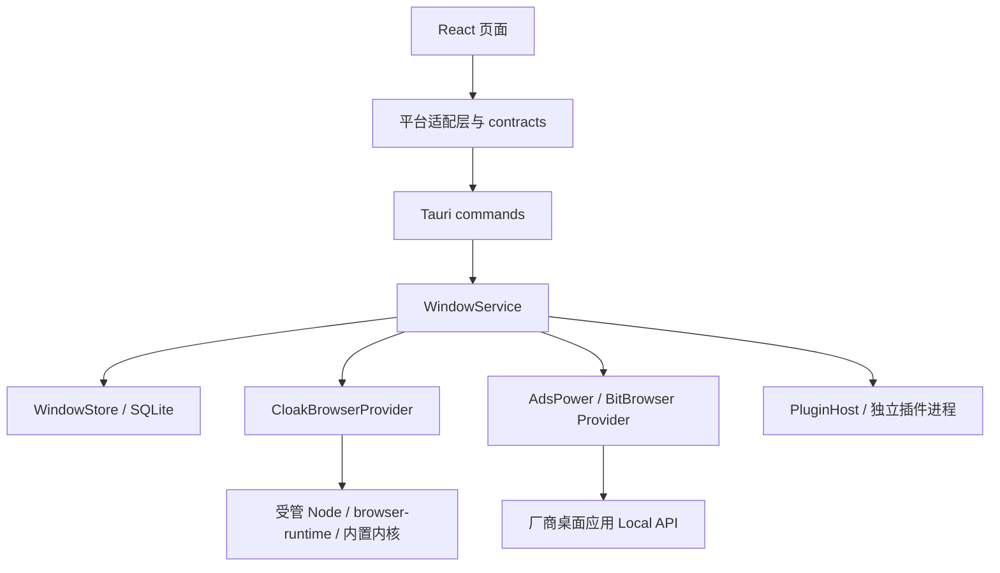

# 系统架构与进程边界

## 当前架构

桌面端通过 React → 平台适配层 → Tauri command → Rust `WindowService`
统一管理内置 CloakBrowser、AdsPower 和比特浏览器窗口。
窗口、分组、浏览器连接、操作记录和会话观察由 Rust 写入 SQLite；
外观和工作区偏好仍使用当前来源的 localStorage。
浏览器预览加载同一前端，但不能执行原生命令，也不以演示数据替代原生调用失败。

`WindowService` 负责业务窗口、连接范围、操作协调、插件关联和迁移互斥，
按绑定分派到 `BrowserProvider`。内置 `CloakBrowserProvider` 持有授权、运行时、
内核缓存、应用网络配置和受管浏览器会话，通过 Node.js 适配器调用官方 SDK。
AdsPower、比特浏览器适配器通过各自桌面应用的 Local API 操作环境，
不使用内置 Node 浏览器运行时，也不复制厂商资料目录。
插件由独立的 `core::plugin_host` 托管为 Node.js 子进程。

## 目录职责

| 目录                                                | 当前职责                                          |
| --------------------------------------------------- | ------------------------------------------------- |
| `apps/desktop/src`                                  | 页面、连接和能力入口、统一窗口 DTO 与平台调用     |
| `apps/desktop/src-tauri/src/core/window_service.rs` | 窗口编排、状态、操作恢复、迁移和安装互斥          |
| `apps/desktop/src-tauri/src/core/window_store.rs`   | `WindowRecord` v2 校验与持久化                    |
| `apps/desktop/src-tauri/src/core/browser`           | Provider、连接、Local API、操作和观察记录         |
| `apps/desktop/src-tauri/src/core/database.rs`       | SQLite 初始化与唯一一次既有数据库升级             |
| `packages/contracts`                                | 共享 DTO 与边界结构校验                           |
| `packages/plugin-sdk`                               | 插件 manifest、能力和迁移接口契约                 |
| `packages/browser-runtime`                          | 仅供内置浏览器使用的 schema2 运行时与便携状态处理 |

共享包通过公开导出使用，不反向依赖桌面页面。前端调用位于
`lib/platform/windows.ts`、`browser-connections.ts` 和 `native-transfer.ts`。
手写契约不等于自动生成的跨语言绑定；类型检查也不等于真实厂商运行验证。

## 窗口身份与连接范围

所有浏览器共用 `WindowRecord.schema_version = 2`。Nexus UUID 是业务窗口标识，
也是账号等插件关联使用的 `windowId`。`BrowserBinding` 保存
`provider_id`、`connection_id`、`profile_id`；最后一项才是 Provider 的环境标识。
不能拿厂商环境 ID 替换 Nexus UUID，或仅凭名称把窗口重新绑定到其他账户。

内置接入固定为 `builtin-cloakbrowser`。外部连接保存本机 API 地址、可选 API Key、
默认厂商分组、账户或工作区说明及确认状态。同一 Provider 同时只启用一个连接，
停用的历史连接及其窗口绑定仍保留。切换厂商账户或工作区应建立新连接。

API 可达只证明服务响应，当前外部探测不提供稳定的账户范围 ID。
用户必须人工确认正在使用的账户或工作区；说明文字是用户声明，不是已核验身份。
修改连接、应用重新启动或外部观察失败后需要重新确认，确认前阻断外部写操作。

## 能力与生命周期

页面和后端按 Provider 能力控制创建、编辑、接管、代理、指纹、内核与转移入口，
不能因使用统一 DTO 就推定功能对所有浏览器相同。
AdsPower 编辑和插件代理在验证完成前不可用；具体能力及限制见
[浏览器接入](05-browser-integration.md)。外部环境的指纹和内核由厂商管理，
不接受 Nexus 数字指纹种子或内置内核选择。

窗口状态为 `stopped`、`starting`、`running`、`stopping`、`unknown`、`missing`。
API 失败进入未知语义，不能显示为已停止；环境缺失也不自动删除插件关联。
外部环境可由厂商应用启动，Nexus 的观察记录不代表拥有其进程。
退出或更新 Nexus 不应自动关闭第三方环境；解除 Nexus 关联与删除厂商环境是独立选择。

内置浏览器在启动前生成不可变配置快照，并持有窗口独占锁。
代理是必需项时，解析、鉴权或连接失败必须阻断启动，不自动直连。
内置运行时的 `NEXUS_READY`、插件握手的 `ready` 和外部 API 观察各有独立含义，
不能互相替代。创建等写操作先保存操作记录；结果不明时显式协调，不盲目重放请求。
状态查询使用操作版本避免迟到结果覆盖新会话。恢复中的启动确认运行后仍保留占用，
迁移和安装分别先持有互锁再核对当前状态。无法自动确认的外部结果提供明确的人工关联或结束，
保留原操作和窗口身份；配置恢复依据提交时的字段散列，不依赖插件后来变化的默认代理。

## 数据与格式边界

Rust 是业务 SQLite 的唯一所有者；React、Node 适配器与插件不直接写入主程序数据库。
`profile_records` 是保留的内部表名，其 JSON 已统一为窗口记录 v2。
仅在启动初始化时，对既有 SQLite 数据执行一次 SQL 升级；
正常读取不再接受旧记录、扫描旧目录或导入旧 `profile.json`。
公开窗口命令使用 `browser_window_*`，迁移与同步使用 `window_transfer_*`、
`window_sync_*`，不保留旧 `profile_*` 命令别名或运行时兼容读取器。

加密窗口快照仅接受 manifest3，内部携带 v2 记录和能力快照。
整批导出前检查 Provider，任何外部窗口都会使整批失败；
同步插件只传输同一加密文件，不能绕过内置浏览器限制或旧格式拒绝规则。
加密容器、便携站点状态和同步传输各自维护版本，不能与 manifest 版本混用。

## 证据与后续边界

本模块描述当前源码分层与契约，不宣称本次执行了 Rust、真实厂商或 Windows 测试。
受信任插件进程及 manifest 权限检查不构成操作系统沙箱。
数据库和插件私有存储的明文边界见[本地数据](07-data-storage.md)，
运行时及代理规则见[浏览器接入](05-browser-integration.md)，
操作恢复见[核心后端](12-core-backend.md)，加密快照见[窗口加密迁移](28-window-transfer.md)。
实际检查结果统一记录于[质量与验证](09-quality-and-testing.md)。
Manager 仅作参考，不成为服务、数据库或模块依赖。
