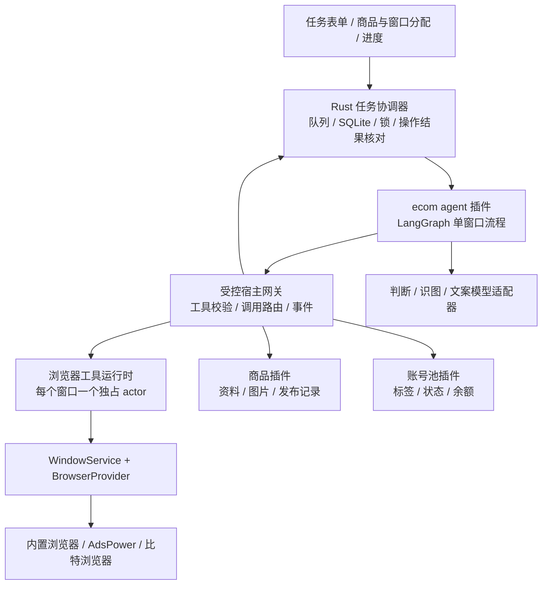

# ecom agent 架构与执行规范

更新日期：2026-11-13。已按获批方案接入 `studio.sales-agent` 源码、
Rust 持久任务协调器、Playwright 工具层与真实商品库页面。
核心版本为 `0.1.29`，插件版本为 `1.0.0`，展示名统一为 `ecom agent`。
已完成本地 macOS Apple Silicon 安装包构建，插件及配套商品库、账号池已发布至 R2。
已执行的检查与尚未执行的原生、厂商和平台验收见[质量记录](09-quality-and-testing.md)。
历史[交互原型](42-sales-agent-demo.md)不是生产任务执行入口。

## 选型结论

采用 **LangGraph.js + Rust 任务协调器 + Playwright 浏览器工具层**。
浏览器自动化选型已由用户确认采用 Playwright，沿用现有 TypeScript / `playwright-core`
依赖和受管 Node 运行时；不引入 DrissionPage 或 Python 运行时。
LangGraph 只嵌入现有 Node 插件进程；不要求用户安装 Python、Docker、
独立工作流服务器或数据库，也不依赖 LangSmith 云服务才能运行。
`@langchain/langgraph` 固定为 `1.7.4`，仅在 ecom agent 插件中运行。
Rust 协调器逐步调用图，每次 RPC 只推进一个有截止时间的节点；
检查点经反向宿主请求存入 Rust 管理的 SQLite。

| 选项                                  | 适合本项目的部分                                                               | 取舍                                                                                                              |
| ------------------------------------- | ------------------------------------------------------------------------------ | ----------------------------------------------------------------------------------------------------------------- |
| LangGraph.js，MIT                     | 显式状态图、分支、暂停恢复、按 thread 隔离的检查点，能组合确定性工具和模型步骤 | 推荐；需要实现 Rust 存储适配和项目自己的外部操作核对                                                              |
| OpenAI Agents SDK for TypeScript，MIT | 工具调用、Agent 作为工具、handoff、代码编排                                    | 可作为轻量备选；业务任务队列、浏览器锁和发布恢复仍需项目自己完成                                                  |
| Mastra                                | TypeScript 工作流、嵌套流程、暂停恢复和模型集成                                | 可行，但与现有宿主职责重合较多；核心主要为 Apache-2.0，`ee/` 目录另有企业许可证，不能把整个仓库称为同一开源许可证 |

本项目的难点是固定商品归属、多账号互斥、确认外部发布结果和恢复任务，
因此优先采用显式工作流。框架负责走哪一步，Rust 负责哪项任务有资格执行。
不让一个自由规划的聊天 Agent 决定所有窗口的启停、分配和重试。
LangGraph 的检查点也不能代替平台写入结果的确认。

## 与现有代码的连接

当前已经具备：

- Rust 的 `WindowService`、`BrowserProvider`、SQLite 操作意图、窗口绑定和运行预留。
- 独立 Node 插件进程，以及宿主到插件的有截止时间 RPC。
- 商品插件的稳定商品 UUID、有序图片、修订号和发布事实记录。
- 账号池、生图和其他插件各自拥有的业务资料。
- 真实ecom agent 页面：商品库选择、批量编辑、固定高度分配、任务与事件分页。

新增实现分别位于 `packages/plugin-sdk/src/agent.ts`、
`plugins/sales-agent`、`apps/desktop/src-tauri/src/core/agent`、
`packages/browser-runtime/src/automation.ts` 与
`apps/desktop/src/features/sales-agent`。
普通 `plugin_call` 不能自行申请浏览器控制权；只有协调器派发的当前作业 scope
可使用反向宿主网关。提供方在独立自动化扩展中附着现有环境，
不改变原有 `start_profile` 的生命周期职责，也不向 UI 或模型暴露 CDP。



这里的 actor 是同一个受管 Node 运行时中的独立窗口控制对象，
不表示每个窗口必须启动一个新的操作系统进程。
商品图片、账号资料和模型消息都不能使用跨窗口共享的可变全局对象。

## 职责与数据归属

| 层                  | 负责                                                                 | 持久化归属                         |
| ------------------- | -------------------------------------------------------------------- | ---------------------------------- |
| React               | 编辑分配、运行前批量表单、确认、暂停、查看进度与异常                 | 不在页面计时器中驱动任务           |
| Rust 通用任务协调器 | 父任务、子任务、快照、资源占用、调度、取消、事件、恢复与结果同步收据 | Rust 独占 SQLite                   |
| ecom agent 插件     | 上架、消息、账号检查状态图；平台适配；模型判断与文案步骤             | 工作流检查点通过宿主存储端口持久化 |
| 浏览器工具层        | 绑定窗口的页面、登录态请求、表单操作、证据采集                       | 工件只保存受控引用，句柄只留在内存 |
| 商品插件            | 可编辑商品、图片和已确认发布历史                                     | 现有插件私有文件                   |
| 账号池插件          | 账号身份、标签、观察到的余额与账号状态                               | 现有账号业务存储                   |
| AI 生图插件         | 生成素材，用户导入后成为独立商品                                     | 不作为 Agent 的商品身份来源        |

Rust 核心保持抽象，不包含 Vinted 表单选择器、Jev 提示词或平台余额字段规则。
平台逻辑放在ecom agent 插件的平台适配器中；跨插件关系继续使用 Nexus UUID。
账号检查只通过专用局部更新契约写回观察结果，不能用 AI 拼出的完整账号覆盖密码、
手机号、邮箱绑定或用户备注。当前通过 `vinted.accounts.observations.record`
幂等写回，并用 `vinted.accounts.agent.snapshot` 获取绑定身份与观察快照。

LangGraph 使用自定义 checkpointer，把检查点交给 Rust 存储端口，
不在 Node 中另开 SQLite 连接。适配器必须支持检查点、节点 pending writes、
命名空间、读取与清理，而不是只存一份最后的 JSON。
检查点带工作流版本和修订控制，写入成功后才能进入要求持久性的下一步。
关键外部操作仍单独使用 Rust 的操作日志，不依赖图状态的异步保存时机。

## 父任务如何管理

父任务是确定性的协调记录，默认不需要一个持续思考的“大 Agent”。
自然语言指令可先交给一次规划调用，生成严格校验的 Task DSL，再让用户确认。
已在表单中指定的商品、窗口、价格与执行范围具有优先级，规划器不能重新分配。

建议最小任务层次：

```text
Batch
  id / preset / instruction / concurrency / policyVersion
  confirmedAssignments / immutableArtifactRefs / modelSelectionSnapshot
  WindowJob[]
    id / windowId / accountId / browserBindingSnapshot / graphThreadId
    ProductItem[] 或 MessageItem[]
      id / sourceId / sourceRevision / frozenContent / actionOperationId
```

一批中每个商品 UUID 只能分给一个窗口，数据库约束再次验证；
已有发布历史的商品默认拒绝作为新的上架任务，不允许模型把它偷偷移到另一个账号。
商品库能保存多个真实历史事实，不等于 Agent 获得自动重复刊登的权限。
同账号被多个窗口绑定时，仍按平台账号身份串行执行。

确认后复制商品资料和图片到任务工件区，校验 MIME、大小和 SHA-256。
只固定商品 revision 而继续读取可变商品图片并不充分；
原商品编辑、删图或删除不能改变运行中的快照。
模型和规则版本也随任务保存，不把 `latest` 别名未来的行为冒充原始执行环境。

父任务汇总成功、跳过、封禁、等待处理、失败、取消和待同步数量。
某个子任务失败不会取消其他窗口；有待核对结果时父任务不能显示“全部完成”。
暂停只停止派发新步骤；已提交的平台写入进入结果核对。
取消保留已完成事实，不能撤回已经成功的刊登或消息。
恢复后先核对资源与外部动作，再推进可执行的子任务。
任务在 Nexus 运行期间执行；退出应用后保留检查点，重新打开后核对并恢复，
不把本地插件进程描述为应用关闭后仍持续工作的系统服务。

## 多窗口并发

选择 100 个窗口代表 100 份独立作业，建议初始全局并发默认 3，
允许在设置中调整；这是本方案的保守默认值，需用真实内存、平台及提供方容量测量后校准。
实际并发取以下约束共同允许的数量：

- 用户设置的全局活动窗口数。
- BrowserProvider 当前能够执行的数量；不能猜测上游许可证席位。
- 单个 Nexus 窗口、绑定平台账号、`(connectionId, profileId)` 的独占占用。
- 平台与账号级请求速率、冷却时间和模型请求池容量。

同一窗口中的三件商品按顺序执行；不同窗口在这些限制内并行。
浏览器池与模型池分开管理，避免一个慢识图调用无限占据所有模型槽位。
短暂平台限流只暂停相应账号或提供方队列，不立即把账号标记成 blocked。

每个窗口使用独立 `WindowJob` 和 LangGraph `thread_id`。
父任务在 Rust 中逐个派发，不把 100 个窗口塞进同一个图 superstep 并等待整体成功。
这让账号封禁、节点报错和恢复都能局限在单个作业。
相同作业的崩溃恢复沿用 thread；明确创建新尝试时记录新的 attempt，
继承已有外部动作记录，不能用换 thread 的方式忘掉已提交操作。
资源申请在一次短事务中检查全部互斥键，冲突就留在队列，
不持有部分窗口或账号锁等待另一项资源，也不在全局锁内等待网络或模型响应。

资源租约应包含 `leaseId`、持有者、递增 fencing token、心跳与截止时间。
每个浏览器动作经过受控网关验证窗口、账号、任务和 token。
**租约过期不等于旧浏览器控制器已经停止**：必须终止或隔离旧 actor，
等待在途动作收敛并核对结果后，才能把同一个窗口交给新作业。
不把原始 CDP 地址作为可长期重用的模型工具参数。

人工接管使用明确的“暂停并接管”动作，先停止自动控制再交给用户。
不能宣称可以可靠识别用户在厂商原生窗口里进行的所有手工操作。
窗口断线、状态未知或环境不可见都不释放占用，也不清除账号关系。

## 是否需要 sub-agent

需要的是**按窗口隔离的执行子流程**。每个子流程有自己的上下文、工具作用域、
浏览器 actor、取消信号、检查点和运行事件，逻辑上相当于一个 worker/sub-agent。
100 个窗口不必创建 100 个互相对话、递归委派的自主聊天 Agent。

| 任务                             | 推荐形态                                |
| -------------------------------- | --------------------------------------- |
| 批次分派、汇总、限速与取消       | Rust 确定性协调器                       |
| 单窗口账号检查、上架、消息流程   | LangGraph 独立状态图                    |
| 账号分类、文案评估、商品适配判断 | 有输入输出 schema 的模型工具            |
| 英文文案生成与有限次数改写       | 生成模型工具或有次数上限的子图          |
| 不确定页面操作的局部计划         | 有步骤、时间和成本上限的受限 Agent 节点 |

内容评估节点可以并行读取同一份不可变素材，但不能同时驱动同一个浏览器页面。
只有单窗口执行器拥有该窗口的写动作权限。
后续确有跨平台研究或复杂售后需求，再增加专门 sub-agent；
首个正式实现不采用自由递归 supervisor 网络。

## 模型分工与 Jev

Jev 用于标签选择、状态判断、文案是否符合预设、置信度与路由等结构化决策。
它返回类型化答案和概率，不能负责生成改写后的标题、描述或回复。
这些输出交给生成模型，要求英文、符合二手商品语气，并保留用户确认的商品事实。
同一多模态生成模型可以兼任识图与文案，不必新增一个强制配置的“文案模型”。

截至方案日期，官方文档说明 Jev 1.13/1.14 支持图片，Box 需要 1.14，
但图片和 Box 仍为实验能力，需要每次请求带
`TypeSafe-Danger-Zone-Images: true`。
因此 Jev 图片评估作为可选适配，默认生产路径需有经过评估的视觉模型替代。
不把“像 AI”的模型评分描述为能证明图片来源的检测器。

建议返回 `pass | skip | review`，同时保留分值、证据摘要、模型与规则版本。
明显不符合照片要求的商品跳过；结果不确定时等待处理，不能默认通过。
文案改写建议最多两轮，仍不通过就停止该商品；避免无限改写和重复请求。
价格、成色、尺寸、材质、库存等缺失事实不能凭模型猜测。
分类继续选填，平台必填项在执行前明确提示补齐。

账号 blocked 以官方强状态优先，确认后停止该账号所有后续写任务，
其他账号继续。模型可归类页面证据，但普通 403、代理失败或网络超时不能自动判封禁。
余额应记录币种、可用、待结算、来源与观察时间；取不到时保留旧值并显示观察失败，
不能写成零。模型判断不能覆盖官方已经确认的强状态。

## Agent Tools 与平台访问

工具用严格 schema 声明输入输出，固定当前作业的窗口和账号，
不让模型随意切换 `windowId`、传入任意 Cookie 或执行无范围的 JavaScript。
下表是工具职责划分；实际公开协议与方法见下文“宿主扩展与长任务协议”，
不能将示例名称当成任意插件均可调用的通用 RPC：

| 工具组   | 示例                                                                                       |
| -------- | ------------------------------------------------------------------------------------------ |
| 商品     | `getProductSnapshot`、`getProductImage`、`validateListingMaterial`                         |
| 账号     | `readAuthenticatedIdentity`、`readAccountState`、`readBalance`、`recordAccountObservation` |
| 浏览器   | `readPage`、`navigateAllowed`、`fillListing`、`readListingForm`                            |
| 外部写入 | `submitListingOnce`、`reconcileListing`、`sendMessageOnce`                                 |
| 模型     | `classifyAccount`、`reviewImage`、`reviewCopy`、`rewriteCopy`                              |
| 结果     | `confirmAction`、`enqueuePublicationSync`、`emitProgress`                                  |

优先封装平台允许使用的登录态结构化接口；重复的字段读取、余额查询和表单校验
采用确定性函数，减少整页截图和重复模型调用。
接口不可用时切换经过验证的页面流程，不能让模型猜一个私有端点反复请求。

需要当前指纹环境时，在绑定窗口的真实页面中执行受控的同源请求。
直接把 Cookie 放进 Node `fetch` 或 Playwright API 请求，
不代表拥有该浏览器的 TLS 指纹和网络路径。
登录态 HTTP 适配与页面适配都要验证实际身份、响应和代理，不新建一个丢失 profile 的上下文。

浏览器工具层统一使用 Playwright API，各提供方按以下方式取得绑定环境的会话：

| 提供方            | 自动化会话来源                                                          |
| ----------------- | ----------------------------------------------------------------------- |
| 内置 CloakBrowser | 复用现有 SDK `launchPersistentContext()` 返回的 `BrowserContext / Page` |
| AdsPower          | 通过提供方的会话扩展取得调试端点，再使用 `connectOverCDP()` 附着        |
| 比特浏览器        | 通过提供方的会话扩展取得调试端点，再使用 `connectOverCDP()` 附着        |

浏览器二进制、profile、代理和生命周期继续由对应 BrowserProvider 管理，
自动化操作沿用窗口已有的登录态与环境配置。
`BrowserContext / Page` 句柄留在持有会话的受管运行时进程，
Agent 经宿主网关调用受控工具，不跨进程传递这些对象。
Playwright 官方说明 CDP 只适用于 Chromium 且能力低于原生 Playwright 协议；
统一 API 不代表厂商行为完全一致，三类浏览器仍须分别验证页面附着、上传、弹窗和断线恢复。
自动化会话端口必须通过 BrowserProvider 的独立扩展提供，
不能在 Agent 插件中重新实现三套窗口启动器。

网络遵循现有边界：平台操作使用窗口必需代理，失败时不回退直连；
模型请求使用应用代理；本机厂商管理 API 仍单独直连并验证 loopback。
消息正文、商品页面和远端页面都是待处理数据，不可作为更改工具权限的指令。
ecom agent 是受信任插件进程，不宣称 manifest 能将其变成安全沙箱。

## 上架流程与发布记录

建议单件商品状态流：

```text
queued -> preflight -> reviewing -> preparing -> intent_saved
       -> submitting -> confirming -> published -> syncing -> completed
```

其他分支包括 `skipped`、`blocked`、`review_required`、`failed`、`cancelled`；
提交后的超时进入 `result_unknown -> reconciling`，不直接回到 submitting。

正常执行顺序：

1. 校验商品快照、图片组、指定窗口、绑定账号和必需字段，取得独占资源。
2. 附着真实环境，确认登录身份符合绑定；读取状态、余额和必要账号资料。
3. 评估图片及英文文案，必要时有限次改写，再验证商品事实没有变化。
4. 准备表单并保存提交前核对基线；读回标题、描述、价格和币种，确认与快照一致。
5. 再次核对身份、封禁状态和租约，将发布意图、内容摘要、账号、快照 revision 和稳定操作 ID 写入 Rust。
6. 提交一次，获取并验证平台刊登 ID、URL、归属账号及成功证据。
7. Rust 原子保存确认事实和待同步 outbox，避免结果确认后因进程退出丢失记录。
8. 宿主幂等调用商品插件 `products.publications.record`，成功后完成同步收据。

商品插件本轮增加的发布记录端口接受已确认事实，**不负责调用平台发布**。
字段包括商品 UUID、执行操作 ID、Nexus 窗口 UUID 与名称快照、平台、
刊登 ID/URL、发布时的商品修订和时间。普通商品编辑不能删除这些记录。
详情和写入回执保持有界，完整发布历史单独分页读取。
商品列表的“已发布”来自持久记录，不来自窗口分配、点击运行或 demo 结果。
它表示历史上成功发布过，不保证远端商品现在仍在线；撤架、售出与远端状态同步另立后续契约。

发布后商品被编辑，仍按当时的 `productRevision` 记录结果。
若商品插件暂时不可用，显示“已发布，记录待同步”，只重试记录同步，
不得再次点击平台发布。商品已被删除或同操作内容冲突时转人工处理，
保留主任务中的已确认事实，不能重建商品或伪造同步成功。

## 结果不明、重试与重启

外部平台不提供幂等键时，不能承诺端到端 exactly-once。
采用至少一次调度、稳定操作 ID、本地幂等、外部读回和不确定状态阻断。
LangGraph 重放节点前，工具先读取动作日志：已确认则返回原结果，
已提交未确认则只核对；没有证据表明未提交，不能重新发送。

| 情况                         | 处理                                                      |
| ---------------------------- | --------------------------------------------------------- |
| 模型读取失败、提交前只读超时 | 有次数上限的退避，可按账号暂停                            |
| 明确账号 blocked             | 停该账号后续作业，保留其他账号执行                        |
| 点击发布后超时或进程崩溃     | 锁定该账号写任务，读回刊登记录；无法确认则等待人工        |
| 外部发布成功、插件记录失败   | 仅重试 outbox，不重新上架                                 |
| 用户取消时发布正在响应       | 标记取消请求，先核对该次外部结果                          |
| 插件或应用重启               | 恢复任务、检查点和 outbox；核对 actor、绑定与操作，再续跑 |
| 自动化连接断开               | 保留未知状态和资源占用，不按已停止处理                    |

消息发送也使用意图、单次提交与读回；无法确认是否发送时不自动再发。
账号检查可以单独排队，但不能与同账号的其他浏览器写任务竞争页面。

## 宿主扩展与长任务协议

现有插件 RPC 的单次截止时间最多 120 秒，单行最多 1 MiB。
正式 Agent 不能把完整的数十分钟批次塞进一个 `plugin_call` 等待响应。
已增加版本明确的宿主网关：短调用提交/查询，后台执行，事件按游标读取。
反向宿主请求有独立消息类型、request ID、权限、截止时间和取消语义，
避免宿主等待插件结果时阻塞插件发回的工具请求。
不通过拼接旧协议字段或读取旧格式来获得这些能力。

当前实现的端口职责：

- 通用任务端口：创建快照、取得/续租资源、状态转换、意图与结果提交、事件及 outbox。
- 工作流存储端口：按任务/thread/namespace 保存和读取检查点、pending writes 与版本。
- 跨插件路由：限制可调用的目标能力和方法，核对安装代次，插件升级时暂停相关步骤。
- 浏览器自动化端口：获取作用域内会话、串行工具操作、失效隔离与释放。
- 工件端口：复制/读取受控图片和证据，保持字节大小、摘要与保留期限。

事件保存单调序号和任务修订，UI 断线后按游标补齐，并能重新读取状态快照。
图 checkpoint 只放有界结构、素材引用和动作 ID，
图片字节、完整 DOM、Cookie 和长日志不塞进 1 MiB 的协议行或模型上下文。
当前限制单批 100 个窗口、100 件商品或消息、并发 1–10，
单件浏览器步骤 5–60、文案改写 0–2 次，并限制请求、作业时长、图片和检查点大小。
工作流存储在 `put` / `putWrites` 的同一事务内压缩已消费历史，
保留最近 8 个完整检查点及其 pending writes；
保护当前保存的检查点和尚无检查点的提前写入，后者不阻止其他已消费历史回收。
持久化压缩边界阻止已丢弃 ID 被迟到请求重建，已有提前写入对应的迟到检查点仍可保存。
压缩不删除动作日志、outbox 或最新状态中的提交前基线；未消费写入仍受原有配额限制。
模型许可、用量收据、草稿模板、通知 outbox 和保留策略同样由 Rust 管理，
不依赖页面计时器或 Node 内存完成持久性保证。
凭据按用户约定明文存储，日志与普通事件不回显凭据。

### 原生调用与反向请求

页面通过以下原生命令访问真实任务，不通过浏览器 localStorage 保存业务状态：

| 命令                            | 参数与结果                                                                          |
| ------------------------------- | ----------------------------------------------------------------------------------- |
| `sales_agent_batch_create`      | `{ input: AgentBatchCreate }` → 批次                                                |
| `sales_agent_batch_list`        | `{ page, pageSize }` → 批次分页                                                     |
| `sales_agent_batch_get`         | `{ id, page, pageSize }` → 批次与窗口作业分页                                       |
| `sales_agent_batch_control`     | `{ id, action: pause / resume / cancel / reconcile / takeover }` → 批次             |
| `sales_agent_job_control`       | `{ id, action: pause / resume / cancel / takeover }` → 单个窗口作业                 |
| `sales_agent_preflight`         | `{ input }` → 保存资料检查、在线核对边界与可操作问题                                |
| `sales_agent_items`             | `{ id: jobId, page, pageSize, attentionOnly? }` → 商品分页                          |
| `sales_agent_item_control`      | `{ jobId, productId, action: skip / revise / approve, override? }` → 操作修订       |
| `sales_agent_artifact_preview`  | `{ jobId, artifactId }` → 受控图片预览                                              |
| `sales_agent_workspace_list`    | `{ kind?, page, pageSize }` → 草稿或模板摘要分页                                    |
| `sales_agent_workspace_get`     | `{ id }` → 草稿或模板及修订号                                                       |
| `sales_agent_workspace_save`    | `{ input }` → 按期望修订保存的记录                                                  |
| `sales_agent_workspace_delete`  | `{ id, expectedRevision }` → 删除收据                                               |
| `sales_agent_usage`             | `{ id: batchId }` → 模型用量、费用估算和通知状态                                    |
| `sales_agent_model_requests`    | `{ id: batchId, page, pageSize }` → 不含凭据与请求体的模型请求明细分页              |
| `sales_agent_retention_preview` | `{ days }` → 可清理与受保护数量、素材大小和预览 token                               |
| `sales_agent_retention_clean`   | `{ token }` → 删除批次数及实际释放字节                                              |
| `sales_agent_attention`         | `{ page, pageSize }` → 待处理作业分页                                               |
| `sales_agent_related`           | `{ kind: product / window / account, id, page, pageSize }` → 来源关联的全部状态历史 |
| `sales_agent_events`            | `{ id, cursor, limit }` → 事件游标分页                                              |

插件方法为 `salesAgent.settings.get/save`、`salesAgent.models.test`、
`salesAgent.jobs.step`、内部 `salesAgent.notifications.send`
与通用 `configuration.export/validate/import`。
模型测试实际请求已保存的端点：决策测试验证判断协议；
生成测试携带受控图片，分别检查视觉结果与英文生成结果。
测试只验证该次请求，不保证判断准确率，也不证明平台账号在线。
本地回归使用受控服务，没有真实视觉模型或真实计费验收。
不把“已保存配置”当成测试通过。
运行中的作业使用创建时固定的模型设置，后续修改只影响新批次。

反向消息使用独立的 `type: "host.request"` / `"host.response"`、
`hostVersion: 1` 与 requestId。scope 包含 batchId、jobId、windowId、
accountId、leaseId 和 fence；宿主校验插件进程代次及当前租约。
方法白名单为 `agent.browser.execute`、`agent.artifact.read`、
`agent.checkpoint.get/list/put/putWrites/delete`、
`agent.action.get/prepare/unknown/confirm`、`agent.controls.get`、
`agent.model.acquire/complete` 与 `agent.plugin.call`。
跨插件路由仅允许指定账号观察和商品发布记录，不提供任意插件调用器。
模型申请只选择冻结设置中的决策或生成模型，不接受任意端点。
模型许可持久化 requestId、scope、进程代次、截止时间和完成收据，
与浏览器窗口槽位分开调度；完成收据幂等，不因图重放清零费用。
普通 WebView 调用不能直接派发图步骤、通知、账号观察或发布事实写入。

### 当前流程与恢复

首次身份核对后单独读取余额与卖家证据，再分类并写回账号池；
提交前的身份复核不会为查询余额而离开已经准备的表单。
余额不可用时保留已有金额，不能记为零；页面证据不标成官方接口证据。
上架前读回标题、描述、价格和币种；消息任务读回指定会话中的完整消息。
提交前的页面或消息 ID 基线先进入检查点，确认时排除已有刊登和历史相同消息。

`submit` 与 `confirm` 阶段先读取动作日志。已有意图只能核对，
已有确认只同步原回执；即使提交后检查点丢失，也不会重新提交。
商品发布与待同步 outbox 在同一事务落盘。同步暂时失败仅重试登记，
同一窗口后续商品仍由原图继续推进，不以第一件同步成功结束整份作业。

### 完整能力补齐

本次获批范围见[补齐设计](superpowers/specs/2026-11-13-sales-agent-completion-design.md)。
在现有协调器内接入提交前安全读取与模型请求的持久退避、平台冷却、
提供方设置上限与独立模型池，以及批次和单窗口人工接管。
窗口隔离反馈使用 `none / stopping / ready / blocked`，
不能以按钮点击或租约到期直接宣称可以人工操作。

商品操作采用带修订号的控制记录，叠加在不可变原始快照之上。
已提交、结果不明和待同步商品只能核对，不允许改写后重发。
结果页丢失时只读查询本人近期刊登；基线排除、事实比对和候选唯一性
均满足后才能确认，证据不足仍等待处理。

SQLite 草稿与模板只保存稳定关系和用户编辑值，载入时重新读取当前来源。
未分配商品的修改使用 `unassignedOverrides` 保留，不能同时出现在窗口分配中，
避免保存不完整草稿时丢失已编辑内容。
工作台聚合待处理商品，保留原文、候选、判断原因和首图。
商品、账号与窗口页可跳转到包含已结束任务的关联历史。
操作步骤与错误恢复见[ecom agent 操作](46-sales-agent-operations.md)。

可选 Bark 使用持久通知 outbox，按批次和事件类型去重、有限重试。
通知链接通过已安装应用的 `nexus` 协议打开只读任务页面；
同实例唤起由官方 deep-link 与 single-instance 插件处理。
任务请求次数、耗时、已取得的 token 和已配置价格的估算费用单独统计。
逐次请求明细提供稳定排序与分页，展示模型类型、结果、开始时间、耗时、
token、可取得的 HTTP 状态及费用估算；不返回端点、密钥、scope 或请求体。
过期且没有完成收据的请求展示未知，不推断成失败或免费。
费用预算按已确认且已知的消费控制下一次请求；配置费用预算的同一批次
串行等待用量回执，未知费用阻断后续请求。
没有用量时不能按免费处理；已经获准的单次调用仍可能超过剩余估算，
预算不能撤回已发出的请求与费用，不能作为服务商账单的硬上限。

历史保留默认不自动清理。显式预览后执行事务核对，
保护未知提交、待同步、资源占用、在途模型请求和待发送通知，
并独立保留已确认商品发布事实与批次创建操作 ID、内容摘要。
清理后重复或冲突的创建请求继续被拒绝，消息任务同样不能重放。
磁盘清理失败保留收据供后续恢复。
逐项源码、实际检查和尚未执行的原生验收统一记入
[实施审计](45-sales-agent-implementation-audit.md)。

## 实施顺序与验收

以下为验收矩阵。源码接入、受控测试和真实厂商验收分别记录，
不能用 mock 或单独的页面检查冒充平台成功上架。

| 阶段               | 实施内容                                        | 必须通过的验收                                                                  |
| ------------------ | ----------------------------------------------- | ------------------------------------------------------------------------------- |
| 宿主基础           | 任务存储、网关、租约、检查点适配、事件和 outbox | 重启、乱序/迟到回执、写入失败、插件退出和重复请求                               |
| 浏览器端口         | 各 Provider 自动化会话和独占 actor              | 三类浏览器分别验证身份、代理、附着、上传和断线；旧 actor 未收敛不能续租给新作业 |
| 只读账号流程       | 身份、标签、余额、强状态与账号池局部更新        | 无登录/身份不符停止；余额未知不写零；blocked 停该账号                           |
| Post Listing       | 快照、评估、改写、表单读回、提交核对和记录同步  | 多窗口隔离、不可重复商品、发布结果不明不重发、已发布事实可恢复                  |
| Message 与运营任务 | 指定账号/会话范围、发送意图与核对               | 不越出指定窗口；未知发送结果不重复；批次暂停取消可恢复                          |
| 产品化验收         | 真实任务面板、成本、日志、恢复入口和发行        | 100 个排队窗口、有界并发、公平性、Windows/macOS 与真实受控账号环境              |

正式平台验收使用用户提供的受控账号与指定商品，不对真实生产账号试探发布。
本地继续遵守不构建、不执行 Rust 编译测试的约定，原生验收交由适用 CI 和受控设备。

## 官方参考

以下为方案日期核对的官方资料；选型与系统边界是本项目建议，不是上游对 Nexus 的保证。

- [LangGraph.js 仓库与 MIT 许可证](https://github.com/langchain-ai/langgraphjs)
- [LangGraph 持久化](https://docs.langchain.com/oss/javascript/langgraph/persistence)
- [LangGraph 检查点](https://docs.langchain.com/oss/javascript/langgraph/checkpointers)
- [OpenAI Agents SDK 编排模式](https://openai.github.io/openai-agents-js/guides/multi-agent/)
- [OpenAI Agents SDK 许可证](https://github.com/openai/openai-agents-js/blob/main/LICENSE)
- [Mastra 工作流](https://mastra.ai/docs/workflows/overview)
- [Mastra 许可证边界](https://github.com/mastra-ai/mastra/blob/main/LICENSE.md)
- [CloakBrowser JavaScript SDK 与持久上下文](https://github.com/CloakHQ/CloakBrowser/blob/main/js/README.md)
- [Playwright connectOverCDP](https://playwright.dev/docs/api/class-browsertype#browser-type-connect-over-cdp)
- [TypeSafe System One / Jev](https://docs.typesafe.ai/concepts/system-one.md)
- [TypeSafe 图片与实验能力](https://docs.typesafe.ai/images.md)
