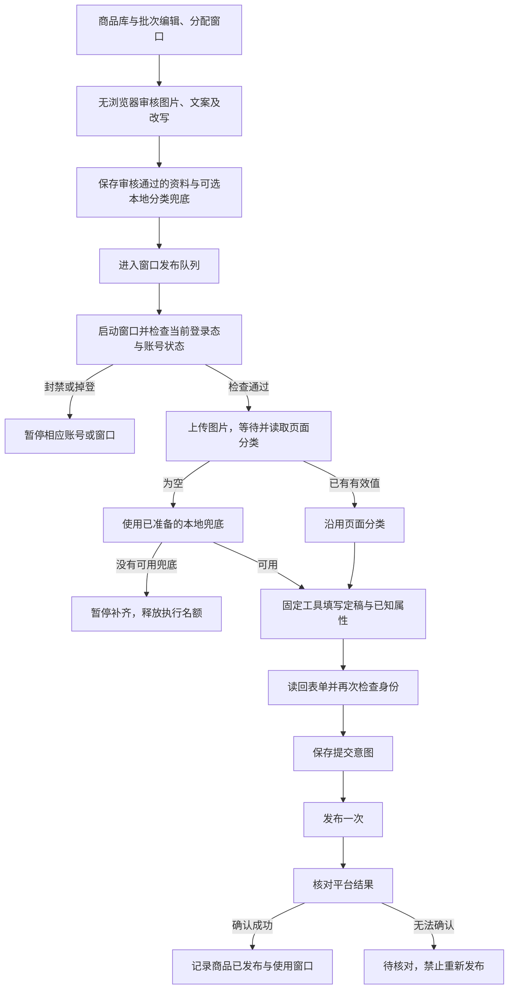

# Vinted 账号检查、分类与上架业务方案

日期：2026-11-14。状态：核心流程已接入源码，受控验证与真实平台验收分开记录。

本方案采用固定上架工具执行、AI 辅助判断。商品和执行窗口由用户事先指定，
图片和文案在执行前审核，常规表单填写不逐控件请求模型。
本轮实现独立内容准备、确定性上架、逐窗口掉登观察、主页与财务回填，
以及未知提交优先核对。美国分类目录已清洗并纳入插件资源；
当前发布链路可消费手动确认的本地分类，逐层 Jev 推荐库仍需接入用户确认入口。
操作与恢复说明见 [Ecom Agent 操作](46-sales-agent-operations.md)。

同日业务补充已纳入：优先使用上传图片后页面自动填写的分类；
current 回填账号主页；通过对应窗口读取 wardrobe、余额和收款账户。
接口字段以用户提供的响应为设计依据，没有使用真实登录环境执行这些读取。

## 1. 业务目标与选择

用户在商品库准备资料，在 Ecom Agent 中批量分配商品和窗口。
系统在启动发布窗口前审核图片、文案和已知商品资料；
窗口启动后检查登录状态和账号限制，使用确定性浏览器工具完成上架，
确认真实平台结果后再记录商品已发布及使用窗口。

| 方案                         | 正常表单操作               | 异常处理                       | 取舍                               |
| ---------------------------- | -------------------------- | ------------------------------ | ---------------------------------- |
| 旧的逐步 AI 规划             | 每个控件动作都可能调用模型 | 模型规划下一步                 | 本轮已从正常上架表单路径移除       |
| 固定工具与 AI 辅助，本次采用 | 工具按平台规则直接操作     | AI 分析和建议，无法确认时暂停  | 符合资料事先准备好的工作方式       |
| 接口直接提交商品             | 绕过页面提交表单           | 需独立维护上传、属性和发布协议 | 本次不采用，尚无经过验证的发布协议 |

采用第二项。当前不让 AI 在页面变化时自动接管未知控件、生成脚本或修改执行权限；
无法核实的页面变化进入待处理。
确定性工具可以处理已经适配的常规弹窗，不需要遇到任何弹窗都停。

分类以用户提供的本地美国站目录为准，不在应用启动或每次上架时联网下载。
后续需要更新时，由维护者替换数据并发布新插件，用户无需下载目录或配置文件。

## 2. 谁负责维护资料

| 位置                | 保存内容                                             | 与其他位置的关系               |
| ------------------- | ---------------------------------------------------- | ------------------------------ |
| 商品库              | 原始英文标题、描述、价格、币种、图片和已知商品事实   | 可供多个批次复用               |
| 商品库的平台资料    | 美国站候选分类、目录版本及已知属性                   | 页面未自动分类时提供兜底       |
| Ecom Agent 草稿     | 商品与窗口分配、本批次修改值、待补齐项               | 不自动覆盖商品库原文           |
| 执行前准备记录      | 图片与文案审核、改写后的定稿、素材摘要及可选分类兜底 | 不启动浏览器，不占窗口执行名额 |
| Ecom Agent 执行记录 | 不可变商品快照、页面实际分类、工具进度与提交回执     | 运行中不随商品库编辑变化       |
| 账号池              | 主页、账号状态、逐窗口登录观察、画像、余额与收款信息 | 不覆盖密码、联系方式或用户备注 |

分类在商品库仍可留空。运行前可以准备本地候选分类，但没有候选不阻止已通过内容审核的商品
进入窗口发布：页面可能在图片上传后自动填好分类。
提交前必须取得平台实际接受的分类；页面为空且兜底也不可用时才进入待补齐。
不要求为没有使用的本地候选预先进行人工确认。

### 内容审核先于窗口执行

执行前使用商品实际图片及本批次标题、描述审核，必要的英文改写也在此完成。
审核通过后保存可发布资料包，关联商品修订、图片内容摘要、最终文案、平台和审核规则版本。
同一份资料用于多个窗口时可以复用有效审核结果，不为每个窗口重复识图或改写。

审核阶段不能启动、连接或占用浏览器窗口；没有通过审核的商品不进入发布队列。
发布窗口只消费已确认资料，执行登录态检查、上传、填表、读回、提交与结果核对。
执行期间不再调用图片审核、文案审核、改写或分类模型。
图片或文案发生变化时，停止该商品的执行并返回准备阶段，释放窗口执行名额后重新审核。
已提交或结果不明的商品仍先核对原提交，不能换一份资料重新发布。

## 3. 账号检查的业务判定

所有登录态读取均通过目标窗口自己的浏览器环境，在同源页面中请求
`GET /api/v2/users/current`。沿用该窗口的 profile、Cookie 和必需代理。
读取成功还要核对平台用户 ID 与绑定账号一致。

以下两项规则来自用户提供的 current 响应，不将它们当作已经公开验证的完整平台协议：

| 证据                                                                    | 业务结果                       | 后续动作                             |
| ----------------------------------------------------------------------- | ------------------------------ | ------------------------------------ |
| 有效 current 用户，身份匹配，`is_account_banned === true`               | 账号封禁 `blocked`             | 写入官方观察，停止该账号的后续写任务 |
| current 返回 JSON：`code === 106` 且 `message_code === "access_denied"` | 当前窗口掉登 `logged_out`      | 暂停该窗口写任务，提示重新登录       |
| current 返回有效用户且身份匹配                                          | 当前窗口已登录 `authenticated` | 继续核对封禁、限制和表单要求         |
| 返回的用户 ID 不符合绑定                                                | 登录了其他账号                 | 停止执行，不改绑、不覆盖原账号资料   |
| 普通 403、验证码 HTML、超时、代理失败或无法解析                         | 检查失败或未知                 | 显示具体问题，不判封禁或掉登         |

错误响应需先保留 HTTP 状态和 JSON 业务码，再执行分类。
不能先把所有非 200 或非零业务码变成通用错误，否则会丢失掉登证据。
`106/access_denied` 规则仅用于该窗口的 current 接口，不能套用到任意商品接口。

`is_account_banned === false` 只说明该次响应没有给出封禁标志，
不能单独清除已有封禁、受限或待验证状态。
`account_status: 8`、`action_restriction` 等字段没有经过验证的完整映射，
暂存为可核对证据；遇到未知限制暂停写入，不由 AI 猜测代码含义。
`is_online: false` 不代表掉登；邮箱或手机未验证也不能直接推导成封禁。

### 账号状态与掉登状态分开

账号封禁和浏览器掉登可以同时存在，应分别保存：

- 账号状态沿用正常、待验证、受限、封禁；它描述账号业务状态。
- 窗口登录状态增加已登录、掉登、未知，并保留检查时间和检查结果。
- 账号池展示登录状态标签和筛选；掉登不是替换 `blocked` 的第五个互斥账号状态。
- 同一账号关联多个窗口时分别记录。全部已绑定窗口都明确掉登才汇总为掉登；
  部分掉登显示数量，存在未知时显示相应说明。没有绑定窗口显示未检查。

账号池保留封禁红色标记。执行窗口列表可筛选掉登，掉登窗口不能执行发布或发送；
允许排队进行只读状态复查。
重启后保留历史观察并显示时间，重新执行写任务前仍须检查当前登录态。

### 重新登录和解除阻断

用户在原窗口重新登录后点击重新检查。只有 current 再次确认身份匹配，
才把该窗口登录观察更新为已登录；页面打开、按钮点击或模型判断不能代替这项证据。
登录恢复不会清除账号封禁，也不会自动恢复曾经结果不明的提交。

明确封禁会阻断同一平台账号的其他窗口写任务；
掉登只作用于该窗口，不把另一个已登录窗口一并判为掉登。
已发出的写请求无法撤回，停止意图先持久化，随后核对在途结果。

### 主页、余额和收款信息回填

current 身份核对通过后，把 `user.profile_url` 写入对应账号的 `homepageUrl`。
必须验证站点、HTTPS 和 `/member/<id>` 中的 ID 与 current 及账号绑定相符；
同一 ID 的昵称后缀变化可以更新，其他账号的主页不能覆盖。
缺少或无效的链接保留原值，不由模型补造。主页更新沿用已有订单查询启用逻辑，
不通过整条账号 `save` 覆盖密码、备注、号码等其他字段。

余额使用用户提供的 wallet 接口：`main` 为可用余额，`escrow` 为待结算余额。
每项金额连同自身币种、来源和检查时间保存，使用十进制字符串，未知不等于零。
两项币种不同则分别显示，不合并、不换算。

bank_accounts 的收款账户列表保存到当前账号，包括平台记录 ID、姓名、
平台返回的掩码账户号、routing number、账户类型和默认标记。
保留返回值，不尝试还原掩码；routing number 使用字符串，不能丢掉开头的零。
只有身份确认且响应完整成功时，空列表才表示当前未绑定收款账户；
读取失败保留旧信息并标记最近检查失败。

主页、钱包、收款账户分别保留更新结果与时间。余额失败不撤销已保存的主页，
模型分析失败也不撤销官方状态。财务信息不进入画像模型、截图诊断或普通日志。
本地按既有约定明文持久化，不写 Keychain。
精确接口、字段与写入边界见[账号读取工具](49-vinted-account-read-tools.md)。

## 4. 使用本地分类目录

清洗后的正式数据位于
`plugins/sales-agent/resources/vinted/us-catalogs.json`。
源文件 `catalogs.json` 保持原样，供维护者核对，不要求最终用户持有。

本地目录共有 8 个根分类、2,916 个节点、2,499 个末级节点，最多 5 层。
根分类为 Women、Men、Kids、Home、Electronics、Books & Media、
Hobbies & collectibles、Sports。单个节点最多 20 个子分类。

保留分类 ID、英文名称、用于区分的 `full_title` 和父子关系。
不保存分类图标、缩略图、空徽标、空限制字段、可以从树重建的重复路径和空子数组。
非空 `restricted_to_status_id` 必须保留，不能因为当前快照全为 null 而永久丢弃限制。
数据结构、摘要、清洗方法和验证见[分类数据规范](48-vinted-catalog-data.md)。

### 页面分类优先，本地分类兜底

1. 准备阶段可预先产生本地候选；用户选定的本地分类无需模型重新选择。
2. 未选候选时，当前执行链路不自动指定本地分类。逐层 Jev 推荐库已有实现与受控测试，
   用户确认入口尚未接入；不能将其描述为已经自动应用的分类能力。
3. 发布时先上传图片，等待上传结果与页面分类推荐完成，读回当前真实分类。
4. 页面已有有效分类就沿用，不用本地候选覆盖，也不再请求模型比较两者。
5. 页面最终为空时，才使用准备阶段已确认的兜底；没有可用兜底则暂停补齐。
6. 分类确定后等待其属性控件就绪，读取并记录实际分类 ID、路径和来源。

有效页面值不能是占位文本、尚在加载的控件或单独一个未经核实的名称。
页面稍后自动改写分类时，重新读取相关控件并核对必填资料，不争抢回填本地值。
页面有效分类可以是本地旧目录没有的新 ID；只要页面身份与分类值能够核实，
不会因为本地快照缺少它而强制覆盖或阻断。
本地目录仍不联网更新，该页面值只作为此次准备和提交的实际分类证据。

同名分类必须通过完整路径区分，不能只对比 `Other`、`Accessories` 等末级名称。
若前两条分支接近，保留少量候选路径继续比较，避免第一层选错后一直走错分支。
阈值需要用本项目商品验证，不把 Jev 的 confidence 直接解释成上架正确率。

兜底分类只确定目录归属。这份目录没有品牌、尺码、颜色、包裹规格或其他分类属性定义；
具体必填项仍需在选中分类后的平台表单中检查。
铁皮画、帆布画等材质信息必须来自商品事实，不能通过图片猜测后写成确定事实。

本地目录默认不联网刷新。页面为空且拒绝指定的本地兜底时，
显示分类需要维护，暂停该商品；不擅自换到相近分类或在线覆盖整份目录。

## 5. AI 能总结哪些用户信息

current 提供的是账号事实快照，系统先清洗后使用：

| 内容                                 | 处理方式                                   | 边界                               |
| ------------------------------------ | ------------------------------------------ | ---------------------------------- |
| 身份、国家、币种、创建时间、验证标记 | 代码提取                                   | 不请求模型判断布尔值含义           |
| 封禁、已知限制、掉登                 | 代码按明确证据判定                         | 模型不能覆盖                       |
| 商品和评价计数、评价数值             | 按字段保留来源和时间                       | 不把缺少、null 当成零              |
| 主要销售方向、卖家标签               | Jev 根据自我介绍、已采集商品与评价证据判断 | current 没有这些内容时标记证据不足 |
| 简洁事实摘要                         | 代码使用模板组装                           | 不增加模型调用                     |
| 自然语言卖家画像                     | 可选调用现有生成模型                       | 只使用已有证据，再核对事实         |

Jev 返回的是候选选择、判断和概率，不生成任意自由文本。
因此可以让它选出 `home_seller`、`clothing_seller` 等标签，再由代码生成摘要；
若需要自然的个性化英文简介，使用现有生成模型，不新增第三个强制模型。

仅凭一个空自我介绍、商品数为零的 current 响应，不能总结为“主营家居”或“信誉良好”。
平台统计值、模型推断和缺少证据必须分开显示。
账号池保留当前英文 AI 摘要约定，界面标签继续中文。
原始响应中的邮箱、真实姓名、生日、地址、第三方登录 ID 和匿名跟踪 ID
不进入模型输入或普通日志，不把用户提供的真实样例原文放入仓库。

### wardrobe 提供商品证据与发布核对

通过同一个窗口请求 `/api/v2/wardrobe/{vintedUserId}/items`，
其中 ID 来自已核实的 current，不使用 Raccoon 账号 UUID 或任意输入的用户 ID。
读取时按 pagination 分页，校验每个商品的所有者，区分有限样本与完整扫描。

这份数据可用于主营标签、现有商品清单、提交前基线和发布后查找新刊登。
每项保留 ID、标题、价格与币种、链接、必要图片引用以及平台明确给出的状态标记。
用户提供的两项样例中，`status: "New with tags"` 是成色，不是“在售/已售”；
`is_closed`、`is_hidden` 或 `can_edit: false` 也不能单独证明售出或掉登。
没有明确售出证据时，出售状态保持未知，不能据此伪造订单或已售统计。

列表中的“较新 ID”或同名标题不足以确认一次发布成功；
仍需核对当前账号、提交前基线、图片、价格及必要详情。
分页未完成、列表变化或证据不足时保留待核对，不重复发布。

## 6. 固定上架流程

分类兜底可在上架前批量准备并缓存；没有兜底仍可等待平台自动分类。
所有图片审核、文案审核、改写和分类模型调用均在窗口执行前完成。
审核使用各自输入版本，重复准备相同资料时可复用有效结果。
登录态和封禁检查不能用过期缓存代替。

工具按阶段保存进度，支持暂停、取消及重启恢复。
填写已完成字段时先读回，不因重试无条件追加图片或重复点击按钮。
最后验证标题、描述、价格、币种、分类、可核实属性与图片上传结果。
保存提交意图后出现超时或掉登，只进行结果核对，不重新进入发布动作。

用户修改商品库不改变运行中的快照；未提交商品的批次修订仍需重新验证相关资料。
平台已确认成功而商品库登记失败时显示记录待同步，仅重试登记。

## 7. 业务工具及使用入口

以下名称是方案中的内部业务工具，不是已经开放的新 RPC：

| 工具                       | 用途                                   | 可从哪些流程复用           |
| -------------------------- | -------------------------------------- | -------------------------- |
| `content.prepare`          | 无浏览器审核图片、文案并生成定稿资料包 | 草稿准备、批量预审         |
| `account.inspectCurrent`   | 核对 current、登录态、身份与主页       | 账号池检查、任务前和提交前 |
| `account.readWardrobe`     | 读取本人商品样本或分页清单             | 画像、发布基线及结果核对   |
| `account.readWallet`       | 读取可用与待结算金额                   | 账号检查                   |
| `account.readBankAccounts` | 读取收款账户及默认项                   | 账号检查                   |
| `account.summarize`        | 清洗资料、标签判断及可选英文摘要       | 账号详情、批量账号检查     |
| `catalog.search`           | 搜索本地分类与完整路径                 | 商品编辑、运行前补齐       |
| `catalog.resolve`          | 从本地目录推荐或验证分类               | 商品准备、批量上架         |
| `listing.prepare`          | 按已确认资料确定性操作表单             | Post Listing               |
| `listing.verify`           | 读回并校验完整表单                     | 提交前和恢复准备           |
| `listing.submit`           | 受持久化意图约束的单次提交             | 发布流程内部               |
| `listing.confirm`          | 读取平台证据核对结果                   | 发布后、重启及人工重新核对 |

按钮入口不直接取得任意浏览器控制权。账号池发起的独立检查也进入宿主只读任务，
与现有账号或窗口任务协调；忙碌时排队，不抢占正在填写的页面。
未打开窗口时明确需要启动环境，不能在无浏览器环境的普通 HTTP 请求中冒充登录态。

## 8. 业务验收

| 场景                               | 必须达到的行为                                   |
| ---------------------------------- | ------------------------------------------------ |
| current 明确封禁                   | 不请求模型决定是否继续，立即阻断该账号后续写任务 |
| current 精确返回 106/access_denied | 账号池出现该窗口掉登观察，可筛选和复查           |
| current 主页有效且身份匹配         | 回填主页；保留账号其他字段与订单查询配置         |
| wallet / bank_accounts 成功        | 分别写入对应账号，保留每项来源和检查时间         |
| 财务接口读取失败                   | 保留旧值及旧时间，不显示成零或未绑定             |
| 普通网络失败                       | 不覆盖封禁或登录观察，不把未知显示成正常         |
| 封禁账号随后掉登                   | 同时保留封禁与掉登，不丢失红色封禁标记           |
| 同账号两个窗口仅一个掉登           | 逐窗口展示，另一个窗口状态不被覆盖               |
| 用户重新登录                       | 复查身份后恢复登录观察，未知提交仍不重发         |
| 页面已自动分类                     | 沿用真实页面值，不被本地分类覆盖                 |
| 页面为空且本地无匹配               | 暂停补齐，不在窗口中临时请求模型                 |
| 内容审核或改写                     | 不启动浏览器、不占窗口执行并发；变更使原审核失效 |
| wardrobe 存在关闭或未知状态        | 不把成色、关闭或隐藏直接当成已售                 |
| 缺少尺码或材质等事实               | 提醒补齐，不编造                                 |
| 正常已准备商品                     | 表单阶段不调用 `models.plan`                     |
| 暂停、重启、提交超时               | 进度可恢复，已发出的发布不会自动重复             |

实施范围、协议变化和验证顺序见
[技术设计](superpowers/specs/2026-11-14-vinted-listing-tools-design.md)。
