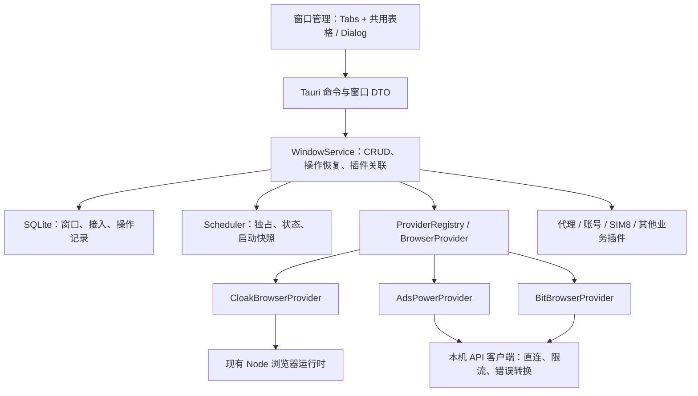

# 多指纹浏览器接入重构方案

日期：2026-11-10

状态：已获用户批准并执行；实际验证以 `docs/09-quality-and-testing.md` 为准。

范围：保留内置浏览器，同时接入 AdsPower、比特浏览器；用户已批准重构，禁止本地构建。
补充约束：删除旧兼容代码，不保留运行时或导入旧格式；仅启动时一次性升级现有 SQLite。

## 1. 目标与建议

将 Nexus 定位为浏览器环境的统一工作台。窗口、分组、账号、手机号和代理的业务入口保持现状，
底层由统一浏览器接口分发到不同产品。用户继续操作“窗口”，无需理解第二套 Profile 管理。

建议在现有 Rust 核心中引入 `BrowserProvider` trait，作为抽象基类的等价接口：

- `CloakBrowserProvider` 复用现有 Node 运行时、内核管理和本地数据目录。
- `AdsPowerProvider` 调用 AdsPower 官方 Local API。
- `BitBrowserProvider` 调用比特浏览器官方 Local API。
- 统一窗口服务处理持久化、调度、操作恢复和插件关联，各适配器处理自己的 API、配置和会话。
- 首页增加紧凑的浏览器 Tabs，复用同一张窗口表格；创建、编辑弹窗按浏览器能力调整字段。

以上决策已获用户批准。实现时使用现有 Tauri、Rust、React、shadcn、
SQLite 和 Node 工具链；优先复用已有开源依赖，不新增 Python 服务、Docker 或面向用户的 CLI 配置。

本次交付目标是三个提供方在其支持范围内的完整接入，包括连接、创建、接入已有环境、编辑、
删除、启停、状态恢复、批量操作和现有插件联动。下文分阶段用于降低改造风险，不是用演示数据交付。

## 2. 当前代码与必须拆开的部分

| 当前位置                                              | 已有行为                                                   | 重构处理                                                       |
| ----------------------------------------------------- | ---------------------------------------------------------- | -------------------------------------------------------------- |
| `apps/desktop/src-tauri/src/core/profile_service.rs`  | 同时管理窗口、激活码、内核、Node 子进程和调度              | 提取统一窗口服务，将激活码、内核和子进程收进内置适配器         |
| `apps/desktop/src-tauri/src/core/profile_store.rs`    | 每条记录必须有 `binary_path`，绑定必须为 `cloak:<version>` | 通用窗口记录与提供方配置分开校验，外部窗口不需要本地二进制路径 |
| `apps/desktop/src-tauri/src/core/scheduler.rs`        | 已有独占、不可变启动快照和 generation 防止过期回调         | 保留这些机制；调度范围不再等同于内核版本                       |
| `packages/browser-runtime/src/profile-runtime.ts`     | 直接调用 CloakBrowser SDK                                  | 继续作为内置适配器的实现，不要求另外两家经过此运行时           |
| `apps/desktop/src-tauri/src/core/transfer_service.rs` | 直接访问内置内核、本地目录及窗口 Store                     | 经可选迁移能力调用，保留已有加密和恢复机制                     |
| `apps/desktop/src/lib/platform/native-profiles.ts`    | DTO 固定内核字段，运行状态只有 `running`                   | 增加提供方绑定、能力和明确状态；命令集中封装                   |
| `apps/desktop/src/features/spaces/window-editor.tsx`  | 新建统一要求内置激活码、内核和数字种子                     | 校验按提供方分发，外部接入不受内置激活码限制                   |
| `apps/desktop/src/features/spaces/window-batch.ts`    | 批量冻结内核，按名称和种子匹配重试结果                     | 改用持久化操作 ID；随机指纹策略归适配器                        |
| `apps/desktop/src-tauri/src/core/group_store.rs`      | 分组计数直接关联 `profile_records`                         | 保留窗口主键和表关联，迁移后计数不变                           |
| `apps/desktop/src-tauri/src/core/updater_service.rs`  | 更新安装与当前会话占用互锁                                 | 区分内置进程、第三方会话和正在进行的操作                       |

现有系统已经包含原生业务和 SQLite。部分早期文档仍描述演示或“后续接入 Rust”，
不能据此退回演示架构。实施时同步更新对应模块文档，保持“已实现”和“规划”分开。

## 3. 实现方式比较

| 方式                             | 优点                                              | 代价                                                                | 结论       |
| -------------------------------- | ------------------------------------------------- | ------------------------------------------------------------------- | ---------- |
| Rust trait + 三个适配器          | 复用已有 SQLite、调度和 HTTP 客户端；进程归属清楚 | 需要拆开现有 `ProfileService`                                       | 推荐       |
| 所有浏览器都经 Node 抽象父类     | TS 接口容易统一，可复用部分自动化代码             | Rust 与 Node 多一层通用命令和状态恢复；纯 HTTP 接入也依赖运行时进程 | 暂不采用   |
| 将每家浏览器直接做成现有业务插件 | 可单独安装和更新                                  | 核心窗口依赖插件启停、权限和协议升级，卸载后的绑定恢复更复杂        | 本次不采用 |

本次提供方作为核心内注册的适配器随主应用发布。新增第四家浏览器需要实现接口、配置映射和契约测试，
不应修改窗口表格的业务逻辑。这里不承诺浏览器适配器可以像商品插件一样热安装。

## 4. 官方 API 核对与接入边界

本节依据 2026-11-10 实际读取的官方文档，来源见文末。没有连接用户的 AdsPower 或比特浏览器，
没有创建、修改或删除真实环境。官方文档存在接口不等于本项目已经完成集成测试。

### 4.1 AdsPower

官方说明 Local API 有套餐权限要求；启用安全校验后使用 `Authorization: Bearer ...`。
文档给出的默认地址包含 `localhost:50325`，实际地址以用户应用配置为准。[A1]

推荐以 V2 的创建、修改、查询、删除和启停为主要接入基线，
它们要求应用支持相应补丁；不将网页里的旧版本号当成当前推荐内核。[A2–A7]

| 统一操作     | 官方接口                                      |
| ------------ | --------------------------------------------- |
| 连通性       | `GET /status`                                 |
| 创建         | `POST /api/v2/browser-profile/create`         |
| 修改         | `POST /api/v2/browser-profile/update`         |
| 查询         | `POST /api/v2/browser-profile/list`           |
| 删除         | `POST /api/v2/browser-profile/delete`         |
| 启动 / 停止  | `POST /api/v2/browser-profile/start` / `stop` |
| 单窗口状态   | `GET /api/v2/browser-profile/active`          |
| 本机活动环境 | `GET /api/v1/browser/local-active`            |
| 可选目标分组 | `GET /api/v1/group/list`                      |

必须单独处理以下差异：

- 列表分页从 1 开始，单页最多 100；请求成功还需检查响应体的业务码。[A4]
- Local API 有频率限制，部分接口另有更严格限制；不能给每行每秒独立轮询。[A1、A10]
- 启动接口可返回调试地址，但不能据此宣称支持完整浏览器数据迁移。[A6]
- 查询文档示例没有完整指纹配置，而修改接口将指纹对象列为必需；
  对既有环境执行局部修改是否保持其余指纹，必须专项验证，不能直接重发随机配置。[A3、A4、A9]
- 跨设备状态接口在某些模式下无法准确反映占用；Nexus 的本机锁不代表厂商全局分布式锁。[A11]

本次不增加另一套 V1 CRUD 兼容实现。V2 不可用时明确提示升级；
文档单独提供的本机活动列表和分组列表使用其现有 V1 路径，这不等于自动回退整套 API。[A8、A12]
删除接口文档的参数大小写等不一致处，以后续受控实测固化契约，不能盲目重试不同写法。

### 4.2 比特浏览器

官方要求先安装并登录应用，从系统设置获取本地接口地址；
接口以 POST JSON 调用，响应中的 `success` 才是业务成功标志。[B1、B3]

| 统一操作     | 官方接口                                         |
| ------------ | ------------------------------------------------ |
| 连通性       | `POST /health`                                   |
| 创建         | `POST /browser/update`，不传 `id`                |
| 修改         | 优先 `POST /browser/update/partial`              |
| 查询 / 详情  | `POST /browser/list` / `browser/detail`          |
| 删除         | `POST /browser/delete`                           |
| 启动 / 停止  | `POST /browser/open` / `browser/close`           |
| 活动状态     | `POST /browser/pids/all` 或 `browser/pids/alive` |
| 可选目标分组 | `POST /group/list`                               |

列表从第 0 页开始；启动可返回调试信息；每次启动随机指纹是独立开关；
子账号创建需要正确的目标分组。这些都在适配器内转换和校验。[B2]

文档示例中的旧内核版本仅作为字段示例，不能硬编码为可选版本。
所读指南没有给出适用于所有安装的 API Key 规则或套餐保证；
接入时按实际版本验证，不能把 AdsPower 的鉴权头照搬过去。

### 4.3 产品接入前提

内置浏览器继续由 Nexus 准备运行时和内核。AdsPower、比特浏览器则由各自桌面应用管理环境，
需要用户已安装、登录并具备相应 API 权限。Nexus 设置页完成连接配置，不要求用户运行脚本。

本次仅接入本机官方 API，不管理远程浏览器服务器，不自动安装第三方应用、
代登录第三方账户或绕过厂商并发限制。没有内置激活码的用户仍可接入可用的外部浏览器。

## 5. 分层与接口



### 5.1 BrowserProvider

使用可放入 `Arc<dyn BrowserProvider>` 的 Rust trait。以下为接口职责，不是待直接复制的可编译代码。

| 接口                                                   | 职责                                            |
| ------------------------------------------------------ | ----------------------------------------------- |
| `descriptor`                                           | 稳定 ID、显示名称、连接配置类型                 |
| `probe`                                                | 连通性、鉴权、API 能力、可取得的账户/工作区标识 |
| `capabilities`                                         | 连接和窗口级能力；包含不可用原因                |
| `list_profiles` / `get_profile`                        | 分页发现、读取官方环境及可验证的配置            |
| `list_target_groups`                                   | 读取可选厂商分组，仅用于设置中的创建目标        |
| `validate_config`                                      | 按提供方和操作类型校验字段                      |
| `create_profile` / `update_profile` / `delete_profile` | 操作官方环境，不写 Nexus 业务表                 |
| `start_profile` / `stop_profile`                       | 启停一个指定环境，返回会话标识或结果不确定      |
| `observe_sessions`                                     | 查询本机运行事实，不将通信失败映射成停止        |
| `reconcile_operation`                                  | 通过环境 ID、操作标记和配置读回确认超时后的结果 |
| 可选 `transfer_adapter`                                | 只有具备完整迁移实现时才提供                    |
| 可选 `automation_endpoint`                             | 提供受控会话连接信息，不代表已实现后台任务      |

复用当前 `reqwest::blocking` 和工作线程模式。Tauri 异步命令将阻塞工作放到受限后台执行器，
不在 UI 线程请求 HTTP，也不在持有全局调度锁或 SQLite 事务时等待网络。
暂不为这一重构引入新的异步框架或深层继承体系。

进程句柄留在内置适配器中；公共会话只保存可比较的提供方会话标识和归属。
外部 API 返回的 PID 用于观察，不作为 Nexus 可任意终止的子进程。

### 5.2 能力声明

使用有类型的能力集合和配置联合类型，避免任意 JSON 和散落的 `if provider == ...`。
能力至少覆盖 CRUD、已有环境接入、代理协议、按 IP 配置、指纹初始化、
内核选择、局部配置修改、自动化连接与完整快照迁移。

每项区分“支持”“不支持”“尚未验证”，并可限定到单个窗口：
例如 Nexus 新建并掌握完整配置的窗口，与只从官方列表接入的窗口，允许编辑的字段可能不同。
后端重复校验能力，不能只靠前端隐藏按钮。

| 能力                      | 内置浏览器               | AdsPower                       | 比特浏览器                         |
| ------------------------- | ------------------------ | ------------------------------ | ---------------------------------- |
| 创建 / 查询 / 启停 / 删除 | 保持现有行为             | 官方提供接口，待集成验证       | 官方提供接口，待集成验证           |
| 编辑名称及配置            | 保持现有校验             | 字段级放行；完整指纹保留需验证 | 优先局部修改；需验证空指纹对象语义 |
| 接入官方已存在环境        | 不增加扫描磁盘入口       | 分页选择后关联                 | 分页选择后关联                     |
| 代理池 / 手动代理         | 现有实现                 | 映射厂商代理对象               | 映射厂商代理字段                   |
| 数字指纹种子              | 保留且创建后固定         | 不声称等价支持                 | 不声称等价支持                     |
| 内核管理                  | Nexus 下载并固定完整版本 | 厂商管理，仅暴露已验证配置     | 厂商管理，仅暴露已验证配置         |
| 完整加密迁移和 P2P 快照   | 保留                     | 本次不开放                     | 本次不开放                         |

外部浏览器的 API 能力及版本差异由适配器集中描述；表格、批量入口和插件不自行猜测。

## 6. 标识、数据与归属

### 6.1 三种标识

| 标识                | 含义                      | 规则                                    |
| ------------------- | ------------------------- | --------------------------------------- |
| `windowId`          | Nexus 窗口 UUID           | 账号、手机号、代理等业务关联继续使用它  |
| `connectionId`      | 一次浏览器账户/工作区接入 | 绑定提供方和作用域；改端口不等于换账户  |
| `providerProfileId` | 官方浏览器环境 ID         | 只在对应接入下解释，不能代替 Nexus UUID |

`providerId` 使用 `cloakbrowser`、`adspower`、`bitbrowser`；UI 显示“内置浏览器 / AdsPower / 比特浏览器”。
已有窗口创建后禁止原地更换提供方、账户作用域或环境 ID。跨产品迁移必须是另一项明确操作，
不通过下拉框把一个账号环境从内置浏览器切到 AdsPower。

本次每种提供方只启用一个接入；数据库保留停用的历史接入及其窗口。
以后换账户时创建新的接入，旧记录不重新指向新账户；切回原接入能恢复原业务关联。
这避免首页再增加多连接筛选器。旧接入可在设置中查看、启用或移除。

### 6.2 SQLite 调整

继续由 Rust 唯一持有数据库；接入配置和凭据按现有要求明文存储，不写 Keychain。

| 表                             | 设计                                                                                    |
| ------------------------------ | --------------------------------------------------------------------------------------- |
| `browser_connections`          | `id`、提供方、名称、endpoint、鉴权配置、作用域证据、配置版本、启用状态                  |
| `profile_records`              | 保留 `id`、`group_id`；增加接入和外部环境索引、稳定排序序号；`record_json` 升级为版本 2 |
| `browser_operations`           | 操作 UUID、窗口/接入、类型、请求摘要、待执行数据、阶段、远端结果、恢复信息              |
| `browser_session_observations` | 每窗口最后观察状态、归属、时间、generation；仅作恢复依据                                |

对已绑定记录建立 `UNIQUE(connection_id, provider_profile_id)`。
创建中的记录可以暂时没有官方 ID，但必须有唯一操作 ID，不能作为已完成窗口反馈成功。
索引列与 JSON 同事务写入并校验一致，不维护两个可独立修改的数据源。

通用记录包含名称、分组、业务备注、业务平台分类、代理来源及版本化配置。
`providerConfig` 为严格区分的三种类型；二进制路径和完整内核版本只在内置配置中必需。
未知的官方字段只作为适配器快照保留，不成为主程序通用配置，不允许前端随意透传执行参数。

操作和会话记录不保存可复用的 WebSocket 连接凭证；应用重启后重新向提供方取得连接信息。
API Key、代理密码和 Cookie 不进入普通日志或错误 toast。

### 6.3 哪些数据以谁为准

| 数据                                               | 权威来源与刷新规则                                       |
| -------------------------------------------------- | -------------------------------------------------------- |
| Nexus UUID、分组、快捷备注、业务平台分类、插件绑定 | Nexus；刷新厂商列表不覆盖                                |
| 厂商环境名称                                       | 提供方；Nexus 编辑成功后刷新，存在待确认修改时先恢复操作 |
| 指纹、内核和浏览器启动配置                         | 提供方；Nexus 缓存已验证字段，修改必须读回或取得明确确认 |
| 代理来源为“沿用浏览器设置”                         | 提供方；Nexus 不写代理、时区或语言                       |
| 代理来源为手动或插件                               | Nexus 保存来源，启动时解析并按已验证接口更新到提供方     |
| 浏览器存储、Cookie、真实运行状态                   | 提供方；SQLite 的历史状态不作为当前运行事实              |

快捷备注只保存到 Nexus，继续支持失焦保存；不拿它覆盖厂商备注。
新建时名称传给厂商，之后名称编辑属于远端操作。若某版本不能安全局部改名，则只读显示并指引在官方应用修改，
不能为改名重新生成指纹。
Nexus 分组不自动创建、移动或删除厂商分组；外部创建使用接入设置中的默认目标分组，
接入已有环境保留其原厂商分组。创建前验证子账号所需的目标分组。

## 7. 接入与配置

设置页新增“浏览器接入”，保留现有页面风格：

- 内置浏览器沿用激活码和内核入口，相关设置只作用于内置适配器。
- AdsPower、比特浏览器提供本机 API 地址、适用的鉴权字段、默认厂商分组和“测试连接”。
- 显示未连接、可用、API 权限不足、版本不支持、作用域待确认等具体状态。
- 保存成功只代表配置已保存；测试通过也不等于创建、代理流量或完整迁移已经通过。

默认厂商分组通过官方分组列表选择，用户无需手写分组 ID。
仅查询和选择，不把 Nexus 分组 CRUD 同步到厂商。[A12、B4]

默认仅允许 loopback endpoint。厂商的 localhost 别名解析后也必须是本机地址。
本机管理 API 使用独立直连客户端，不经过 Nexus 的系统代理、手动代理或环境变量代理；
限制重定向，避免将鉴权头发往其他地址。浏览器访问网站使用其窗口代理，二者分开。

每个接入使用统一请求队列，默认保守限制为每秒 1 个请求，状态查询合并并给用户操作让路。
这是请求发出频率，不是等待上一个启动完成后才允许所有请求继续；
每接入默认允许最多 2 个进行中的变更请求，并为状态核对保留独立读取槽位。
同一窗口的变更始终串行，启动长请求不能阻塞停止确认和其他行的状态刷新。
只读请求可有限退避重试；写请求须依据是否已提交、幂等能力和操作恢复结果决定是否重试。
默认探测 5 秒、普通读取 20 秒、启动 120 秒；到期后进入结果核对，不重新启动一遍。
这些是 Nexus 的初始策略，不是厂商公开 SLA，可按集成结果集中调整。

### 7.1 账户/工作区切换

同一个 localhost 地址可能服务于另一个登录账户，不能仅凭 URL 和环境 ID 自动重绑定。
能取得稳定账户/团队标识时，持久化作用域并在关键操作前核对。
已读官方文档没有证明两家都提供可靠的当前账户查询，因此还要保留证据不足的分支：

1. 初次连接、Nexus 重启或 API 连接恢复后，无法自动验证作用域的接入需要用户在设置中确认当前账户。
2. 操作已绑定环境前读回环境 ID、创建标识和可用的所有者信息；出现不一致，阻断写操作并保留原关联。
3. 健康检测成功、列表为空、名称相同都不能证明账户一致；不能因此批量删除本地记录。
4. 用户明确更换账户时新建作用域；仅修改端口时仍须验证原作用域。

如果厂商不暴露账户身份且在 API 不断连时切换账户，Nexus 无法保证即时发现；
文档和设置需明确这个边界，不能宣称完全自动识别。
依赖字段不足以验证的既有环境，不开放远端删除或覆盖配置，先要求重新核对接入。

## 8. 窗口生命周期与失败恢复

### 8.1 创建与接入已有环境

创建由后端统一编排：

1. 校验接入、能力、字段和代理来源，生成 Nexus UUID 与持久化操作 UUID。
2. 写入 `prepared` 操作记录，再调用官方创建。
3. 新建外部环境在厂商备注中附加稳定 Nexus 操作标记；Nexus 业务备注独立保存。
   适配器负责在后续写入中保留标记，不覆盖用户已有厂商备注。
4. 得到官方 ID 后持久化绑定，核对必要配置，最后提交窗口和插件关联。
5. 网络超时或本地落库失败时，通过标记和分页查询恢复，不根据名称猜测，不再次盲目创建。

恢复阶段：`prepared -> submitted -> confirmed -> committed`；
请求可能生效但没有确认时为 `uncertain`。完全未提交或收到确定拒绝才允许标记失败并重试。
同一个操作 ID 配不同请求内容必须拒绝。

如果厂商未保留标记、分页未完成或找到多个候选，保留待处理记录，
由用户选择“关联已创建环境”或确认结果后重新执行；不自动删除候选环境。
已创建远端但插件绑定失败时只重试本地关联，不删除已成功创建的环境。

“接入已有窗口”打开分页选择 Dialog，仅为用户选中的官方环境分配 Nexus UUID。
不下载厂商浏览器目录，不自动读取所有账号密码或 Cookie。
重复接入同一环境返回已有 Nexus 关联。接入时默认“沿用浏览器设置”，避免默认配置覆盖原指纹和代理。

### 8.2 编辑与删除

编辑前读取当前状态和必要配置，在同一窗口操作锁下完成；只发送用户修改的字段。
保留已知厂商扩展配置，不以 Nexus 表单缺少字段为由清空它们。
如果接口要求全量配置而无法可靠读回，禁用对应字段编辑，明确原因。
外部修改后的读回与本地待确认修改冲突时要求刷新核对，不静默覆盖。

有两种明确操作：

| 操作           | 行为                                                                       |
| -------------- | -------------------------------------------------------------------------- |
| 移出 Nexus     | 解除本地关联和插件关系，不删除厂商环境；不能有未完成操作                   |
| 删除浏览器环境 | 在确认弹窗中明确包含厂商环境；确认已停止、作用域匹配且有权限后调用厂商删除 |

Nexus 创建的外部窗口默认提供“删除浏览器环境”；接入的已有环境默认提供“移出 Nexus”，
远端删除放入单独的明确入口，不依靠隐蔽的默认勾选。
移出 Nexus 不自动关闭外部窗口。内置窗口沿用现有删除本地环境的语义。

删除必须先记录意图。远端删除完成后再清理本地记录和插件绑定；
清理失败保留 tombstone 并恢复，不能重新创建环境来“回滚”删除。
厂商单次查询缺失不自动删除 Nexus 数据；保留“环境不可见”状态供用户核对。
解除账号/手机号关联不删除账号池、号码或代理池本身的数据。

### 8.3 运行状态与并发

替换 `running: boolean`，明确区分：

`stopped`、`starting`、`running`、`stopping`、`unknown`、`missing`。

操作错误与运行状态分开：启动请求失败不必然代表窗口没打开，
`missing` 表示环境无法访问，不能直接解释为已删除。
保留最后观察时间，断线时显示状态待确认；禁止据此再次启动或删除。

启动顺序为：锁定窗口与绑定 -> 核对外部状态 -> 解析必需代理 -> 校验/应用配置 ->
保留启动快照 -> 调用提供方 -> 确认运行 -> 更新页面。
只要用户要求代理，解析失败或无法确认代理配置被接受，就阻断启动，不切回直连。
按 IP 匹配设置映射到提供方支持的机制，不给外部浏览器再套一遍内置 GeoIP 启动门槛。

运行会话记录区分“由 Nexus 请求启动”和“在官方应用中已打开”。
后者显示运行状态但不重复 launch、不覆盖运行中配置；用户明确点击停止时才发送 stop。
启动/停止超时均继续按操作 ID 和 generation 核对，确认停止后才释放占用。

调度按 `connectionId` 管理请求额度，以 `connectionId + providerProfileId` 做本机独占。
并发配额由厂商执行，只有明确可查询的额度才用于前置提示；不设一个跨所有浏览器的 Cloak 限额。
内核版本是窗口配置的一部分，不能作为“一个版本只能开一个窗口”的通用锁键。
本机独占不能代替厂商对多设备或其他客户端的锁。

同一 Nexus 数据目录只允许一个管理进程持有运行锁，第二个实例不能并行恢复操作或调度同一窗口。
运行锁使用随进程退出自动释放的系统锁，不以一个遗留文件是否存在判断占用。

后台统一观察已关联的外部窗口，优先批量查询本机活动列表；不为整张表逐行高频请求。
Nexus 重启先核对未完成操作和官方状态，不自动重开所有历史 `running` 记录。
会话存在但状态服务暂时不可达时保留 `unknown`，提供“重新检查”，不自动宣告已释放。

### 8.4 退出与应用更新

内置浏览器保留现有受控进程生命周期；外部浏览器始终由官方应用拥有。
退出 Nexus 或安装 Nexus 更新不终止第三方应用，也不自动停止其环境。
外部窗口稳定运行本身不阻塞 Nexus 更新；未完成的写操作、迁移和自动化租约仍要先结束或进入可恢复状态。
退出后下一次启动重新观察，不能把旧 PID、旧调试地址当成可用会话。

## 9. 指纹、内核与代理设置

“独立、持久的环境”保持为不变原则；不把不同产品的指纹字段强行等同。

- 内置浏览器保留完整内核包版本、数字种子和本地目录绑定。
- 外部窗口创建时选择提供方支持的配置，已有窗口不自动更换内核或重置指纹。
- 比特浏览器创建时可由厂商生成随机指纹，后续明确禁止每次启动重新随机。
- AdsPower 使用其支持的初次随机策略；不能用一个 Nexus 数字种子声称复现另一家的指纹。
- “按代理 IP 匹配时区、语言和 WebRTC”在新建时保持开启意图，适配器分别映射。
  某字段无法实现时在保存前指出，不静默忽略；已有外部环境默认保留原配置。
- 外部窗口代理新增“沿用浏览器设置”，其他仍用现有手动/代理池入口。
- 代理池占用提示、用户名展示和账号关联按 Nexus UUID 工作，不随提供方重置。

Nexus 内核下载页只管理内置浏览器。外部内核版本若没有可靠的枚举接口，
只展示已知值或经验证的厂商选项，不能复制内置版本列表或提供无效下载按钮。
如果厂商自动更新已绑定内核，记录观察到的变化；不谎报完整二进制版本一直不变。

## 10. 窗口页与其他入口

首页在现有工具栏上方增加一行：

```text
[ 内置浏览器 ] [ AdsPower ] [ 比特浏览器 ]
现有搜索、分组筛选、刷新、创建/批量创建和窗口表格
```

未配置的 Tab 显示简单连接入口，不展示假窗口。Tab 绑定提供方的当前启用接入，
列表只展示已关联到该接入的 Nexus 窗口；“接入已有窗口”位于创建按钮附近。
不增加第二套 Profile 列表页，也不重做账号、号码、备注和代理列。

必须同步处理少量行为差异：

- 新建和批量创建继承当前 Tab；账号池批量创建增加浏览器选择，默认上次的有效选择。
- 创建后提供方只读；弹窗复用通用字段，差异配置放原有浏览器配置区。
- 切 Tab 清空表格选择、关闭针对旧列表的操作弹窗；已有后台任务保留原接入归属。
- 搜索、分页和筛选按接入保存；请求结果带接入和 generation，旧响应不能覆盖新 Tab。
- 每个 Tab 内继续严格按创建时间倒序，同时间以持久化 `sort_seq` 倒序。
  新接入的环境以 Nexus 关联时间排序，厂商创建时间另存，刷新不能改变排序。
- 启动行高亮、启动成功关闭代理弹窗、快捷备注失焦保存、账号筛选、
  电话解绑、短信轮询和 SIM8 到期提醒保持。
- 全局提醒、代理占用和账号已绑定判断覆盖所有接入，不能只看当前 Tab。
- 批量操作仅针对当前接入；批量创建逐项记录操作结果和重试状态。
  内置冻结内核及随机种子的策略保留，外部由适配器生成独立且持久的指纹。
- 分组是 Nexus 的全局业务分组；当前 Tab 的筛选只作用于该提供方，分组页总数包含全部接入。

只有 Tabs 是主要布局变化，但创建校验、设置页、状态与能力提示也必须调整，
否则表格外观看似通用，实际仍只能管理内置浏览器。

## 11. 插件接口与窗口迁移

账号、代理、SIM8 和业务插件继续使用 `windowId`。
本次不要求插件自己学习 AdsPower/比特 API，也不把厂商账户、Cookie 自动灌入账号池。

宿主向需要窗口上下文的能力提供最小描述：窗口 UUID、提供方、支持能力、当前状态。
代理解析仍由宿主调用已有端口，再由适配器转换。未来后台自动化经宿主租约获取会话，
不能因插件安装就获得任意调试地址、厂商 API Key 或关闭全局浏览器的权限。
本次预留这一边界，不同时实现新的无人值守任务系统。

迁移明确分为两类：

- 内置浏览器的加密导出、导入和 P2P 数据快照继续工作，包括现有插件附件及失败补偿。
- 外部浏览器本次不开放 Nexus 完整快照迁移；使用官方自身的环境同步。
  Cookie 读写或 CDP 连接不能作为完整迁移的替代实现。

导出前对整批窗口检查能力；存在不支持项时明确列出并拒绝该批操作，不悄悄漏掉。
P2P 插件继续传输宿主快照，不自行复制第三方目录。宿主返回稳定的“不支持完整迁移”错误。
不将外部配置保存为内置配置，也不把官方云环境 ID 的复制称为浏览器数据迁移。

新快照 manifest 使用版本 3，注明提供方与迁移能力。
仅接受版本 3，版本 2 与其他旧格式在副作用发生前拒绝；保留 Copy / Replace / Preserve 三种导入语义。
新格式不承诺旧版 Nexus 可读；快照加密要求保持不变。

## 12. 现有数据迁移

迁移在数据库打开后、对外开放窗口命令前执行，由版本记录保证可重入：

1. 检查未结束的导入恢复记录；无法按当前格式恢复时停止相关操作并要求从备份处理，
   不保留旧格式读取器，也不绕过恢复锁。
2. 对 SQLite 做一致性备份，包含已提交的 WAL 数据；记录备份和迁移版本。
3. 创建默认内置接入，将所有有效旧窗口绑定到它，官方环境 ID 使用原 UUID。
4. 原 UUID、分组、账号/号码/代理引用、名称、备注、创建时间、内核、种子和数据目录全部保留。
5. 将旧行顺序存为稳定排序序号；转换配置为版本 2，不新建 Profile、不重新生成指纹。
6. 同事务校验行数、绑定唯一性、关系及字段不变量，再切换版本。
7. 提交后重新观察运行状态，不能把迁移前缓存的布尔值当成当前事实。

迁移失败回滚数据库事务，保留备份并显示具体恢复原因；
不清空损坏数据，不把坏记录转换成空白新环境。
迁移本身不搬动浏览器目录；需要目录迁移的其他功能仍通过原有日志恢复机制完成。

删除旧 `ProfileRecord`、`ProfileService`、`ProfileStore` 和 `NativeProfile`，不保留过渡别名或旧命令。
Node runner 仅接受严格 schema 2 `RuntimeWindow`；旧 schema、channel 绑定与缺省字段全部拒绝。
仅数据库启动升级读取旧 schema 1 JSON，升级后所有正常读写均为新格式。
不恢复已删除的 145 基础内核，也不为本次重构增加其兼容逻辑。

新 schema 提交后不支持直接用旧二进制写库。
需要回退时使用一致性备份恢复，并明确升级后新增数据不会自动出现在旧备份里。
上线前必须用脱敏数据库夹具验证这一恢复路径。

## 13. 建议文件边界

以下为本次重构采用的文件边界：

```text
apps/desktop/src-tauri/src/core/
  browser/
    provider.rs             # trait、类型、能力与错误
    registry.rs             # 提供方注册
    connection_store.rs     # 本机接入、鉴权与作用域
    local_api.rs            # 直连 HTTP、限流和请求边界
    operation_store.rs      # 远端操作恢复
    session_store.rs        # 观察记录与重启核对
    providers/
      cloakbrowser.rs
      adspower.rs
      bitbrowser.rs
  window_service.rs         # 统一窗口编排
  window_store.rs            # 严格窗口持久化
  database.rs                # 启动时一次性 SQL 升级
  scheduler.rs               # 提供方无关的独占与状态转换
  transfer_service.rs        # 经提供方能力执行迁移

packages/contracts/src/
  browser.ts                # 提供方、能力和窗口 DTO 的 TS 校验

apps/desktop/src/lib/platform/
  browser-connections.ts
  windows.ts

apps/desktop/src/features/
  spaces/                   # 复用窗口表格和弹窗
  settings/                 # 浏览器接入设置
```

旧 `profile_*` Tauri 命令及其薄入口全部删除，只注册新的窗口、接入与操作命令。
Rust 与 TypeScript 边界采用版本化 DTO 和共享 JSON 夹具验证，
没有生成工具时不将手写类型宣称为自动生成。
提供方错误统一为 `unavailable`、`auth_required`、`permission_denied`、
`unsupported`、`rate_limited`、`profile_missing`、`profile_busy`、
`invalid_config`、`scope_mismatch`、`operation_uncertain` 等可处理分类。

## 14. 实施顺序与验收

实施任务见[执行计划](../plans/2026-11-10-multi-browser-refactor.md)。各阶段保留可检查的结果，源码与受控测试不替代真实厂商验收。

| 阶段                  | 主要工作                                                               | 退出条件                                         |
| --------------------- | ---------------------------------------------------------------------- | ------------------------------------------------ |
| 1. 通用边界与内置迁移 | trait、通用 DTO、Store 迁移、内置适配器；拆开 transfer 和 updater 依赖 | 原窗口、批量、插件和加密迁移行为不回归           |
| 2. 外部连接与操作恢复 | 接入设置、作用域、直连客户端、限流、操作日志、状态核对                 | 断线、超时、重启不误创建、不误停、不误删         |
| 3. AdsPower           | 官方 API、字段映射、已有环境接入、CRUD、代理与并发                     | 使用专用测试环境验证已声明能力，限制项有明确表现 |
| 4. 比特浏览器         | 同一接口下完成第二个外部适配器                                         | 无需修改统一业务逻辑即可通过同套契约             |
| 5. 页面及业务联动     | Tabs、动态表单、批量创建、全局插件关联和迁移能力提示                   | 保留现有表格交互，跨 Tab 和跨接入数据不串        |
| 6. 回归与交付         | 更新模块文档、CI、macOS / Windows 实测和升级回退                       | 满足下列矩阵后再进入用户要求的发布流程           |

重点验收矩阵：

| 范围           | 必须验证的行为                                                                 |
| -------------- | ------------------------------------------------------------------------------ |
| 提供方契约     | 三个适配器返回统一标识和状态；未支持字段不能假成功                             |
| 业务响应       | HTTP 200 但业务失败、错误 JSON、缺失字段、鉴权失败和权限不足正确分类           |
| 分页与限流     | AdsPower 从 1、比特从 0；超过 100 条完整遍历；分页中断不判定环境消失           |
| 远端恢复       | 创建已经成功但响应丢失；修改已生效但本地写入失败；删除后插件清理失败           |
| 独占与迟到回调 | 双击启动、并发批量、启动超时后迟到成功、停止未确认、官方应用手动开关           |
| 应用实例       | 同一数据目录启动两个 Nexus 进程时只有一个可写；崩溃后可重新取得锁并恢复操作    |
| 作用域         | 同地址切账户、改端口、权限丢失、相同外部 ID、恢复连接后待核对                  |
| 代理           | 手动/代理池/沿用设置；有用户名的 SOCKS5；失败不直连；本机 API 不受应用代理影响 |
| 指纹保持       | 连续开关后指纹不重新随机；编辑名称和代理不重置其余配置；实际内核与展示一致     |
| 迁移           | 原 UUID、排序、种子、路径、分组、账号、号码关联不变；v2 快照读取与 v3 导出     |
| UI             | Tabs 响应隔离、紧凑布局、表格备注、账号编辑/筛选、验证码、SIM8 提醒            |
| 更新/退出      | 内置会话锁保留；第三方运行窗口不会被 Nexus 更新误停；未完成操作重启可恢复      |

本地遵守“不构建”约定：只做与改动相关的格式、lint、无产物类型检查和直接调用的 JS 测试。
不运行会先构建依赖的根脚本，不运行本地 Tauri 打包、Rust 编译、Rust 测试或 Clippy。
这些检查交给 CI；真实 API、双平台、代理流量和迁移实测单独记录，mock 通过不能代替。

实施时同步维护 `02`、`03`、`05`、`07`、`11`、`12`、`13`、`14`、`16`、`26`、
`27`、`28`、`29`、`32` 等受影响模块，真实验证结果由主线填入 `09`。
当前工作区的 SIM8 到期提醒改动保留，不在本次设计任务中覆盖、提交或发布。

## 15. 本方案需要确认的默认决策

确认方案时，重点检查这些产品选择：

1. 保留内置浏览器，并列接入 AdsPower、比特浏览器；每家本次启用一个接入。
2. 现有环境自动归到内置 Tab；外部已有环境由用户选择后关联，不自动导入全部账户数据。
3. 窗口提供方和官方环境绑定不可原地切换；业务插件继续关联 Nexus UUID。
4. 外部浏览器沿用官方应用的安装、登录、权限和内核管理。
5. 现有完整数据迁移保留给内置浏览器；外部完整迁移需要独立的已验证实现后才能开放。

这些默认值用于形成可执行的方案，不代表用户已经接受。
没有必须先购买套餐或操作真实账户才能完成的设计步骤；
真实接入验证会在实施阶段使用明确的测试环境。

## 16. 官方资料与核验记录

以下资料于 2026-11-10 通过只读 HTTPS 获取。引用只说明接口契约来源，不代表真实环境测试通过。

- [A1 · AdsPower API Overview](https://localapi-doc-en.adspower.com/docs/Rdw7Iu)
- [A2 · New Profile V2](https://localapi-doc-en.adspower.com/docs/New-Profile-V2)
- [A3 · Update Profile Info V2](https://localapi-doc-en.adspower.com/docs/Update-Profile-Info-V2)
- [A4 · Query Profile V2](https://localapi-doc-en.adspower.com/docs/Query-Profile-V2)
- [A5 · Delete Profile V2](https://localapi-doc-en.adspower.com/docs/Delete-Profile-V2)
- [A6 · Open / Close Browser V2](https://localapi-doc-en.adspower.com/docs/Open-Browser-V2)
  和 [Close Browser V2](https://localapi-doc-en.adspower.com/docs/Close-Browser-V2)
- [A7 · Check Browser Status V2](https://localapi-doc-en.adspower.com/docs/Check-Browser-Status-V2)
- [A8 · 本机活动窗口](https://localapi-doc-en.adspower.com/docs/YjFggL)
  和 [Connection Status](https://localapi-doc-en.adspower.com/docs/6DSiws)
- [A9 · fingerprint_config](https://localapi-doc-en.adspower.com/docs/Awy6Dg)
  和 [user_proxy_config](https://localapi-doc-en.adspower.com/docs/Lb8pOg)
- [A10 · Query profile cookies](https://localapi-doc-en.adspower.com/docs/Query-profile-cookies)
- [A11 · 跨设备状态](https://localapi-doc-en.adspower.com/docs/Check-Browser-Status-crossdevices)
- [A12 · Query Group](https://localapi-doc-en.adspower.com/docs/zSjKAy)
- [B1 · 比特浏览器本地服务指南](https://doc.bitbrowser.cn/api-jie-kou-wen-dang/ben-di-fu-wu-zhi-nan)
- [B2 · 比特浏览器接口](https://doc.bitbrowser.cn/api-jie-kou-wen-dang/liu-lan-qi-jie-kou)
- [B3 · 比特浏览器 API 常见问题](https://doc.bitbrowser.cn/api-jie-kou-wen-dang/api-chang-jian-wen-ti)
- [B4 · 比特浏览器分组接口](https://doc.bitbrowser.cn/api-jie-kou-wen-dang/fen-zu-jie-kou)

本轮证据：已读取代码和官方文档。未执行业务实现、本地构建、真实浏览器 API 调用、
真实代理流量测试、数据库迁移、CI、提交或发布。
